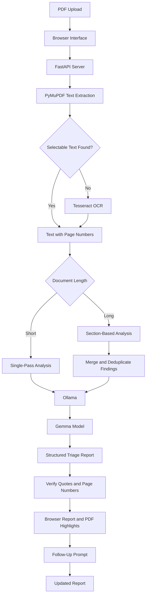

# QUAD-X

## Problem Statement — Agentic AI: Private Legal Document Triage Agent

## System Architecture

QUAD-X is a web-based legal document triage prototype. A browser interface sends PDF files and analysis prompts to a Python API. The API extracts text, optionally uses OCR for scanned pages, and passes the document text to a Gemma model through Ollama.

### Architecture Diagram



### How It Works

1. **PDF Upload:** The browser interface accepts PDF files up to 10 MB and lets users enter a prompt describing what they want reviewed.
2. **Text Extraction and OCR:** PyMuPDF extracts selectable text and preserves page numbers. Pages without a text layer are processed with Tesseract OCR when available. Pages that still have no readable text are reported and skipped.
3. **Legal Analysis:** The analyzer sends the document text and user prompt to the Gemma model through Ollama. The model returns a structured report with a summary and findings, including category, preliminary severity, quotation, page number, explanation, and suggested action.
4. **Long-Document Handling:** Short documents are analyzed in one request. Longer documents are split into sections, analyzed in parts, and merged. Overlapping findings are deduplicated.
5. **Source Checks:** Python checks whether each quotation appears in the extracted text and whether its page number matches. The interface flags unverified quotations and can display verified passages highlighted in the original PDF.
6. **Follow-Up Analysis:** Users can ask follow-up questions to refine the report. For long documents, follow-ups update the existing findings rather than re-reading the full document.
7. **Session Reset:** Users can start a new analysis, which clears the current browser session from the server.

### Technology Stack

- **Python:** Application logic and model integration.
- **HTML, CSS, and JavaScript:** Browser interface and report display.
- **FastAPI:** API server for uploads, analysis status, follow-ups, and source highlights.
- **PyMuPDF:** PDF text extraction, page handling, and quote highlighting.
- **Tesseract OCR:** Optional OCR for scanned pages.
- **Ollama:** Model runtime.
- **Gemma:** Legal document triage.

### Run Locally

Install the Python packages:

```bash
pip install fastapi uvicorn python-multipart pymupdf ollama
```

Install Ollama and download the configured model:

```bash
ollama pull gemma4:e4b
```

To enable OCR for scanned pages, install Tesseract OCR and make sure it is available on your system path.

Place `index.html`, `app.js`, and `style.css` in a folder named `static` beside `server.py`. Then start the server from the project directory:

```bash
uvicorn server:app --port 8000
```

Open the local address shown by the server in your browser.

### Configuration

- `LEGAL_AI_MODEL` selects the Ollama model. The default is `gemma4:e4b`.
- `LEGAL_AI_NUM_CTX` sets the model context window in tokens. The default is `16384`.
- `LEGAL_AI_CHUNK_TOKENS` sets the target size for long-document chunks. The default is `6000`, capped to leave room for prompts and responses.
- OCR uses English (`eng`) by default. The OCR language can be changed in `pdf_utils.py`.

### Privacy and Limitations

The application keeps uploaded PDF bytes, extracted text, and report state in server memory for the active session. Sessions are not stored as permanent files and are lost when the server restarts. Ollama’s host is determined by its runtime configuration, so verify that Ollama is running locally and review your environment settings before uploading sensitive documents.

OCR can make mistakes, and PDF extraction may not preserve tables or complex layouts accurately. Model findings and severity ratings may be incomplete or incorrect. Quote verification confirms wording in extracted text; it does not confirm the model’s interpretation. The project has not undergone a formal privacy or security audit.

**Current status:** The browser interface, PDF upload, text extraction with OCR fallback, local model analysis, long-document processing, quote and page checks, source highlighting, follow-up prompts, and session reset are implemented. QUAD-X provides preliminary legal document triage and does not replace advice from a qualified legal professional.
```

## Front end prototype

