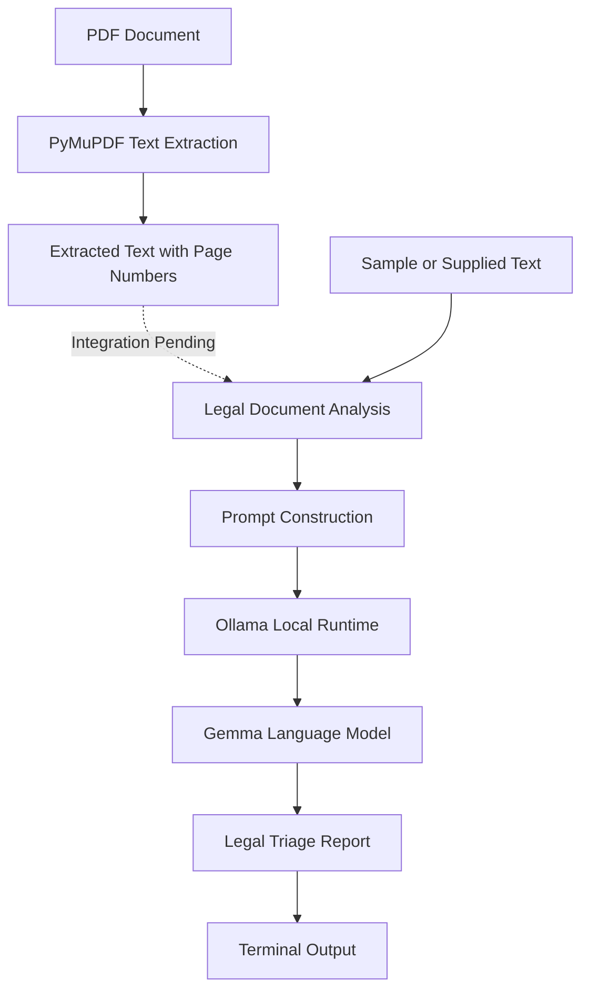

# QUAD-X 
# Problem Statement - Agentic AI: Private Legal Document Triage Agent
## System Architecture

The project consists of three main components: PDF text extraction, legal document analysis, and local language-model inference.

### Architecture Diagram



### How It Works

1. **PDF Extraction:** PyMuPDF extracts text from PDF documents while preserving page numbers.
2. **Legal Analysis:** A Python function analyses supplied document text to identify potential concerns involving financial obligations, penalties, termination, confidentiality, liability, and restrictive clauses.
3. **Local AI Inference:** The analysis prompt is sent to the Gemma model through Ollama, which runs the model locally.
4. **Report Generation:** The model generates a report containing potential issues, preliminary severity ratings, relevant quotations, explanations, and suggested areas for review.

### Technology Stack

- **Python:** Application logic and integration.
- **PyMuPDF:** PDF text extraction.
- **Ollama:** Local model execution.
- **Gemma:** Legal document analysis.

### Privacy and Limitations

The project is designed to process documents locally, reducing the need to send sensitive legal information to external AI services. Network activity and data handling must still be tested to validate the privacy guarantees.

**Current status:** PDF extraction and legal analysis have been implemented as separate scripts. Automatically connecting PDF extraction to the analysis pipeline, validating source quotations, and testing privacy are remaining tasks. The system provides preliminary legal document triage and does not replace professional legal advice.


```[cite: 1]
