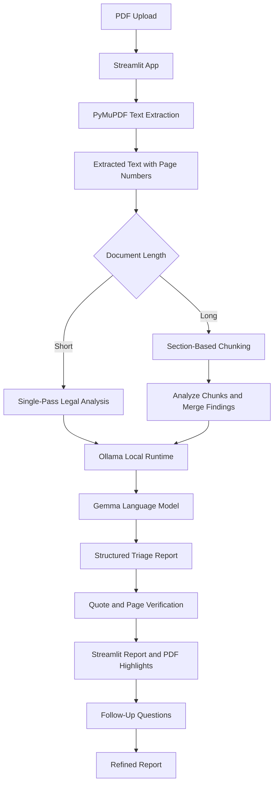

# QUAD-X

## Problem Statement — Agentic AI: Private Legal Document Triage Agent

## System Architecture

The project consists of three main components: PDF text extraction, legal document analysis, and local language-model inference. A Streamlit app connects these components to provide an interactive document review.

### Architecture Diagram

### How It Works

1. **PDF Extraction:** PyMuPDF extracts selectable text page by page while preserving page numbers. Password-protected PDFs are rejected, and pages without selectable text are reported.
2. **Legal Analysis:** The user provides a prompt to guide the review. The analyzer identifies relevant potential contractual concerns and returns a structured report with a summary and findings.
3. **Long-Document Handling:** Short documents are analyzed in one request. Longer documents are divided into sections, analyzed in parts, and merged into a report. Overlapping findings are deduplicated.
4. **Local AI Inference:** The analysis is sent to the configured Gemma model through Ollama at `127.0.0.1:11434`.
5. **Source Checks:** Python checks each quotation against extracted text and checks whether its page number matches. The app flags unverified quotations and can highlight verified passages in the original PDF.
6. **Follow-Up Analysis:** Users can ask follow-up questions to refine the report. For long documents, follow-ups update the existing findings rather than re-reading the full document.

### Technology Stack

- **Python:** Application logic and integration.
- **Streamlit:** Web interface for PDF uploads, analysis, reports, and follow-ups.
- **PyMuPDF:** PDF text extraction and source highlighting.
- **Ollama:** Local model runtime.
- **Gemma:** Legal document triage.

### Privacy and Limitations

The analyzer connects to a local Ollama service and does not send contract text to a remote Ollama host. Run Streamlit locally to keep the interface on your machine. Privacy should still be assessed in the actual environment, including installed software and operating-system network activity. The project has not undergone a formal privacy or security audit.

Scanned PDFs require OCR, which is not included. PDF extraction may not preserve tables or complex layouts accurately. Model findings and severity ratings can be incomplete or incorrect. Quote verification confirms wording in extracted text, not the model’s legal interpretation.

**Current status:** PDF extraction, legal analysis, local inference, long-document chunking, quotation and page checks, PDF highlighting, and follow-up prompts are implemented. The system provides preliminary legal document triage and does not replace professional legal advice.

## Front end prototype

